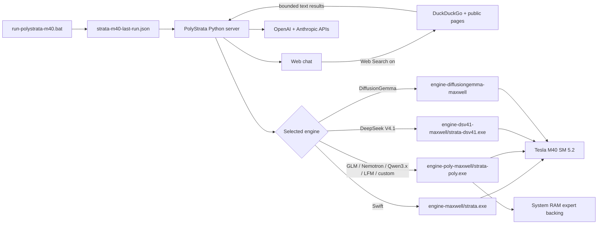

<h1 align="center">PolyStrata M40</h1>

<p align="center"><b>Big local MoE models on a 2015 Tesla, because this old card still has life in it.</b></p>

<p align="center">
  
  
  
  
  
</p>

This is a hardware focused fork of [PolyStrata](https://github.com/VecSzn/PolyStrata), itself built on
[Strata](https://github.com/Niko1221/Strata). It ports both inference engines to native CUDA `sm_52`, adds the
fallbacks missing from current release binaries, and tunes the result for one real **Tesla M40 24 GB** running
Windows Server, driver 528.89, and CUDA 12.0.

> [!IMPORTANT]
> **Start this fork with [`run-polystrata-m40.bat`](run-polystrata-m40.bat).**
> It is the main launcher for this repository. It selects an M40-tuned preset, asks about context,
> drafting, vision, KV compression and network access, then starts the normal PolyStrata web server and API.
> The older `run-<model>.bat` files remain useful as fixed, model specific shortcuts.

## Quick start

1. Install NVIDIA driver **528.89** and CUDA **12.0**. CUDA 13 cannot generate Maxwell code.
2. Keep the locally built engines in `engine-maxwell/` and `engine-poly-maxwell/`.
3. Put the model files at the paths stored in the preset JSON files. If a preset path is missing, the launcher asks
   for the folder containing the GGUF or its first shard.
4. Double click **`run-polystrata-m40.bat`**.
5. Pick a model and answer the prompts. The browser opens when the engine is ready.

The chat composer always includes a **Web Search** button. It is gray and off by default; click it to highlight the
button and let the current chat search DuckDuckGo and read selected public pages. This is a per-browser preference,
so it is available with every model without another launcher question.

The launcher writes the final, reviewable configuration to `strata-m40-last-run.json`. It does not overwrite any
optimized preset. Localhost is the default. LAN mode binds to `0.0.0.0` and requires an API key; a random key is
generated when none is entered.

## M40 presets

| Menu | Model | Engine | Known configuration | M40 validation |
| ---: | --- | --- | --- | --- |
| 1 | Swift Qwen3.8 Flash Next IQ3_S | `strata.exe` | native pack, IQ3_S experts, speculative lookup | Runs "swiftly" at 20-25 tok/s on average |
| 2 | GLM 5.3 Flash UD-IQ3_XXS | `strata-poly.exe` | four GGUF shards, 1,664 MiB workspace reserve | Coherent API answers; about 3.3 tok/s in the recorded short run |
| 3 | NVIDIA Nemotron 3.5 Bolt 74B-A9B UD-Q4_K_XL | `strata-poly.exe` | three shards, batch 1, window 1 | Loaded 50.2 GB; `OK` at about 10.6 tok/s |
| 4 | Qwen3.6 35B-A3B UD-Q4_K_S | `strata-poly.exe` | embedded MTP layer, batch 2,048, tail skip 6 | 1,800-token cold run at 44.6 tok/s; follow-up request passed |
| 5 | Flint Preview UD-Q3_K_XL | `strata-poly.exe` | native SM52 Flint path, FP16 hybrid KV, all experts resident | Coherent 128-token answer at 39.5 tok/s, 180 W |
| 6 | Qwen3.5 122B-A10B Q4_K_M | `strata-poly.exe` | three shards, 32K default, routed expert cache | SM52 engine generation passed; full API validation in progress |
| 7 | LFM2.5 24B-A2B UD-Q4_K_XL | `strata-poly.exe` | all experts fit in the M40 budget, 64K default | Coherent OpenAI API answer at about 54 tok/s |
| 8 | DeepSeek V4.1 Flash 1017 GSQ-RCO IQ2_XS | `strata-dsv41.exe` | dedicated DSV4.1 engine and disk-backed EnGram lookup | SM52 build and executable smoke test passed; full model awaits EnGram |
| pending | DiffusionGemma 26B-A4B Q4_K_M | dedicated diffusion engine | block-diffusion decoder and automatic noncausal context sizing | Native SM52 build and 2K model startup passed; generation untested |

The last menu item is **Try an unsupported model**. It selects a GGUF, extracts its embedded tokenizer, builds a
temporary `strata-poly` configuration, and attempts to start it. That mode is a compatibility probe. It cannot make
an unknown GGUF architecture work by itself.

## What the launcher asks

### Context

Every model gets the same clear ladder:

| Choice | Tokens | Intended use |
| ---: | ---: | --- |
| 1 | 32K | conservative baseline |
| 2 | 64K | normal long chat |
| 3 | 96K | larger working set |
| 4 | 128K | long documents and agents |
| 5 | 192K | near limit for some presets |
| 6 | 256K | experimental; may exhaust VRAM or host commit |

The menu marks a recommended and near-limit choice using the selected preset and total GGUF size. GGUF bytes are
only a rough signal: most routed experts live in system RAM, while the model's attention layout and KV format decide
how quickly context consumes VRAM.

### Runtime features

Prompts are shown one at a time for:

- speculative drafting or MTP where the selected engine/model supplies it;
- vision input, enabled only when a prepared PolyStrata vision section and encoder are available;
- compressed KV cache (`q8_0` for `strata-poly`, `int8` for the Strata engine);
- the in-memory API monitor;
- port and localhost/LAN binding.

None of the current local packs contains vision encoder assets. Choosing vision explains this and accepts a
prepared vision-section JSON rather than inventing paths to files that do not exist.

## Why this fork exists

Upstream targets newer CUDA cards. The M40 has useful capacity and memory bandwidth, but compute capability 5.2
lacks instructions and launch APIs assumed by recent inference kernels:

- no tensor cores, TF32, native BF16 matrix math or `cp.async`;
- no native `__dp4a` integer dot product;
- no `__nanosleep` device instruction;
- no cluster launch or programmatic dependent launch;
- no CUDA virtual memory management on this Windows driver;
- 65,536 registers per block, which rules out some 1,024-thread kernels;
- CUDA 13 no longer emits native Maxwell machine code.

Simply adding `52` to `CMAKE_CUDA_ARCHITECTURES` is insufficient. This fork carries explicit compile-time and
runtime paths for those differences.

## Changes from upstream PolyStrata

### Built-in DuckDuckGo web search

The web chat has an always-present **Web Search** button modeled after the search control in Unsloth Studio. When it
is enabled, the model receives two local tools: `web_search` for DuckDuckGo results and `open_webpage` for reading a
result before answering. PolyStrata executes the calls, adds their results to the conversation, and lets the model
continue for up to the configured MCP round limit. The button is gray when disabled and uses the fork's green accent
when enabled.

No API key or BAT setting is required. Model inference and chat history remain local; only a search query and the
public URLs selected for reading are sent over the network. Page downloads are bounded, reject non-text responses,
and block loopback, private, link-local and other non-public network addresses. Tool results appear as expandable
blocks in the answer, including the source URLs the model can cite. Search adds prompt tokens and additional model
rounds, so it can take longer than an ordinary answer.

### Native SM 5.2 build lane

- `STRATA_EXPERIMENTAL_SM52=ON` is an opt-in CMake configuration.
- It requires CUDA 12.x and `CMAKE_CUDA_ARCHITECTURES=52`.
- Maxwell outputs stay separate in `build-maxwell/`, `engine-maxwell/`, and `engine-poly-maxwell/`.
- Runtime detection admits compute capability 5.2 only in this experimental build.
- `setup.py` recognizes the M40, selects the local CUDA 12 engine, and avoids incompatible release binaries.

Modern GPU defaults remain available in normal builds.

### Maxwell arithmetic and launch fallbacks

| Newer assumption | M40 path in this fork |
| --- | --- |
| native DP4A | signed-byte `vmad` software implementation |
| `__nanosleep` | bounded spin/pause path |
| BF16/tensor matrix hardware | FP32 conversion, cuBLAS and SIMT kernels |
| `cp.async` and fused SM80 prefill | older prompt/decode attention and unfused expert paths |
| packed-half subtraction unavailable on SM52 | FP32 subtraction followed by exact FP16 packing |
| cluster/PDL launch APIs | ordinary CUDA kernel launches |
| 1,024-thread GLM KDA step | 512-thread SM52 launch, with each thread processing more values |

The engine still uses the GPU for inference. CPU work is limited to routed experts that do not fit the expert cache
and the host coordination already present in PolyStrata.

### Tesla M40 memory policy

The installed card exposes **23,040 MiB**. Presets are designed around a **21,888 MiB / 95%** Strata ceiling, leaving
1,152 MiB for CUDA runtime work where the model permits it. GLM uses a larger 1,664 MiB reserve and Swift uses 2,048
MiB because their startup/runtime layouts differ.

CUDA graphs are captured lazily when attention crosses 1K, 2K, 4K and later position ranges. On this driver, graph
storage could consume the startup reserve and fail around token 1,295. The fork now catches graph-instantiation OOM,
rebuilds the partial expert cache with another 256 MiB of headroom, and retries without unloading dense weights, KV
or conversation state. The fixed Qwen3.6 run settled at 21,804 MiB for the process and 21,846 MiB total GPU use.

### Nemotron-H backend

This fork adds the `nemotron_h_moe` path used by NVIDIA Nemotron 3.5 Bolt:

- hybrid Mamba-2 and GQA layers;
- SM52 Mamba recurrence, biased causal convolution and grouped RMS normalization;
- `relu(x)^2` experts on CUDA and CPU;
- sigmoid routing with selection bias and normalized top-k weights;
- per-layer expert counts, widths, input/output dimensions and cache geometry;
- larger GGUF metadata arrays for the model's 88 layers.

The Mamba hardware parity test differed from the CPU reference by at most `5.96e-07`; the ReLU² activation test
matched all 14 values.

### Flint backend

The `flint` path implements the model's two dense leading blocks followed by 47 MoE blocks, sigmoid normalized
top-6 routing over 256 experts, an always-active shared expert, and the GGUF's per-layer full/sliding-attention
and RoPE patterns. Learned denominator sinks are included in both decode and prompt softmax paths. Sliding layers
keep a 513-token ring while only the 14 full-attention layers grow with context.

### New architecture lanes

- **Qwen3.5 MoE** and **LFM2.5 MoE** use the Maxwell `strata-poly` build. Their presets include extracted embedded
  tokenizers, conservative prompt batches and the 21,888 MiB M40 ceiling.
- **DeepSeek V4.1 Flash 1017** uses a separate `strata-dsv41.exe` compiled for SM 5.2. Its GSQ-RCO backbone remains
  in the downloaded GGUF shards while a zero-copy Maya pack indexes those files. The model also requires the
  110.6 GB EnGram lookup and the first Unsloth Q8 shard for token-map metadata; the metadata shard's weights are
  not duplicated into the pack.
- **DiffusionGemma** is a block-diffusion model rather than an autoregressive GGUF. It uses the llama.cpp
  DiffusionGemma decoder ported to native SM 5.2, with tensor-core and flash-attention assumptions disabled and
  an automatically sized noncausal context for the M40's remaining VRAM.

## How it fits together



## Build the Maxwell engines

Use the included build script from this checkout:

```bat
build-strata-maxwell.bat
```

The core configuration behind it is:

```bat
cmake -S . -B build-maxwell -G Ninja ^
  -DSTRATA_ENABLE_CUDA=ON ^
  -DSTRATA_EXPERIMENTAL_SM52=ON ^
  -DCMAKE_CUDA_ARCHITECTURES=52 ^
  -DCMAKE_CUDA_FLAGS=--use-local-env ^
  -DCMAKE_CUDA_COMPILER="C:\Program Files\NVIDIA GPU Computing Toolkit\CUDA\v12.0\bin\nvcc.exe"
```

This machine uses MSVC 14.39. CUDA 12.0 needs `--use-local-env` with that toolchain. Do not substitute a CUDA 13
compiler or an `sm_60` binary; neither produces executable native code for the M40.

## Hardware verification completed

- Tesla M40 24 GB detected as compute capability 5.2, 24 SMs.
- CUDA 12.0.140 native kernel, transfer, and cuBLAS SGEMM smoke checks passed.
- Inspected engine images contain native `sm_52` cubins.
- Attention, routing, RoPE, KV, dequantization, MMVQ, GEMV, DMA, BF16 fallback, recurrence and expert parity suites
  relevant to this port passed on the physical M40.
- Both server engines loaded real models and returned coherent API output.
- Repeated and long-generation checks were run for Qwen3.6 after the CUDA graph memory fix.

Measurements apply to the exact model variants named above. A working kernel test does not validate every model,
quantization or optional fused path.

## Known edges

- This is an experimental, machine-focused fork. The paths and presets currently reflect the installation under
  `D:\polystrata-maxwell` and the local model folders.
- The unsupported-model menu only covers GGUFs whose architecture is already understood by `strata-poly`.
- Vision needs a separately prepared encoder configuration; none is bundled in the four current presets.
- NVFP4 and kernels that fundamentally require newer GPU hardware remain unavailable.
- 192K and 256K contexts can require more VRAM or host commit than a model/preset has been tested with.
- The CUDA 12.0 / driver 528.89 combination is deliberate. Changing either requires fresh hardware validation.

## Repository map

| Path | Purpose |
| --- | --- |
| `run-polystrata-m40.bat` | primary interactive launcher |
| `strata-*.json` | fixed optimized presets |
| `engine-maxwell/` | native SM52 Strata engine |
| `engine-poly-maxwell/` | native SM52 `strata-poly` engine |
| `engine-dsv41-maxwell/` | native SM52 DeepSeek V4.1 engine |
| `engine-diffusiongemma-maxwell/` | native SM52 DiffusionGemma engine |
| `src/poly/` | PolyStrata model backends, including Nemotron-H |
| `include/strata/kernels/maxwell_compat.hpp` | isolated Maxwell compatibility helpers |
| `tools/maxwell_smoke.cu` | physical GPU/CUDA/cuBLAS probe |
| [`docs/MAXWELL.md`](docs/MAXWELL.md) | full compatibility audit and verification record |
| [`docs/MAXWELL_CHANGES.md`](docs/MAXWELL_CHANGES.md) | compact technical change summary |
| [`docs/NEMOTRON_MAXWELL.md`](docs/NEMOTRON_MAXWELL.md) | Nemotron implementation and test record |
| [`docs/QWEN36_MAXWELL.md`](docs/QWEN36_MAXWELL.md) | Qwen3.6 configuration and long-run fix |

## API

The launcher starts the same PolyStrata server as upstream:

- web chat: `http://127.0.0.1:<port>/`
- OpenAI compatible: `/v1/chat/completions`
- Anthropic compatible: `/v1/messages`
- health: `/health`

LAN mode prints the URL and API key before model loading. Keep that key private.

## Credit and license

PolyStrata M40 exists because [PolyStrata](https://github.com/VecSzn/PolyStrata) and
[Strata](https://github.com/Niko1221/Strata) made local MoE inference practical and open. This fork keeps their
architecture, server, APIs and model formats while adding the opt-in Maxwell backend and the model work recorded
here. See [`LICENSE`](LICENSE) for the repository license and the individual model pages for model licenses.
